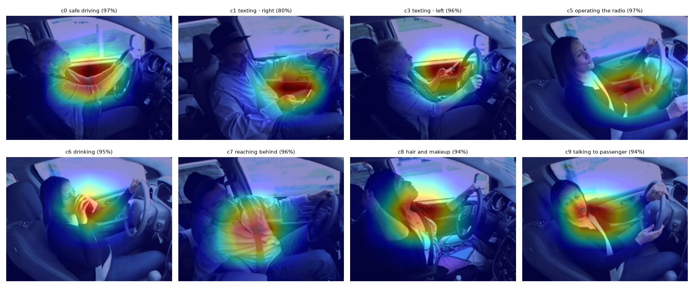
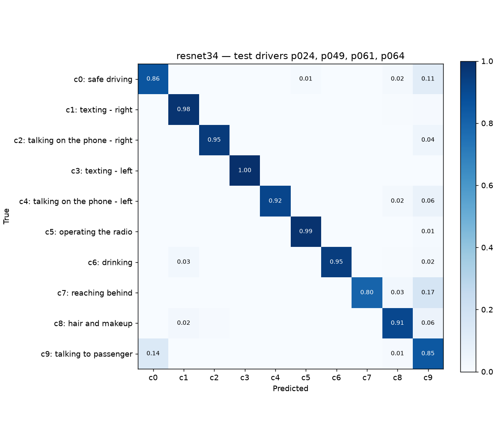
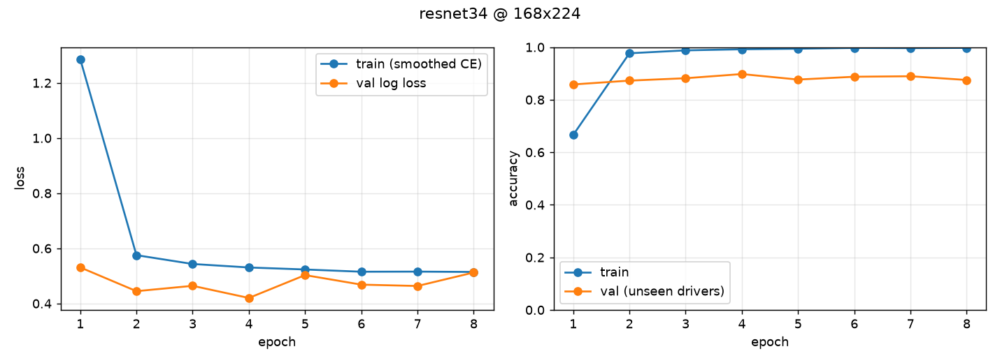
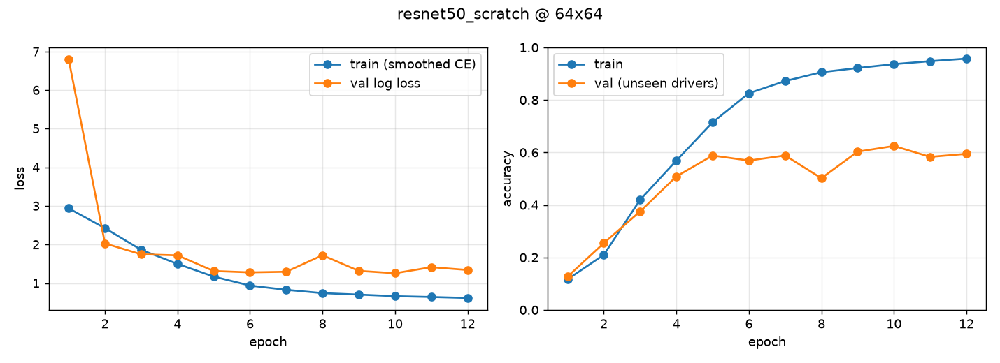

<div align="center">

# 🚗 Distracted Driver Detection — v2

**Classifies 10 driver behaviours from dashboard-camera images (State Farm dataset),
evaluated on drivers the model has never seen.**

`92.3 %` accuracy · `0.291` log loss on held-out drivers — up from `66.5 %` / `1.07` for the original from-scratch ResNet50.



</div>

This is a rebuild of [shsarv/Machine-Learning-Projects › Distracted Driver Detection](https://github.com/shsarv/Machine-Learning-Projects/tree/main/Distracted%20Driver%20Detection).
That project was a single Keras notebook with a hand-built ResNet50. It had several bugs that made its numbers unreliable, and it no longer runs on a modern
stack. [`legacy/ISSUES.md`](legacy/ISSUES.md) lists every problem found. The original notebook is kept unchanged in
[`legacy/original_notebook.ipynb`](legacy/original_notebook.ipynb).

## Results

Both models were trained and evaluated on the **same driver-disjoint split** ([`configs/split.json`](configs/split.json)).
That split has 18 drivers for training, 4 for validation (model selection and calibration) and **4 test drivers who are never used for any
decision**. The test set has 3,866 images.

| Model | Input | Pretrained | Test accuracy | Test log loss ↓ | Test macro-F1 | Train time (M2 laptop) |
|---|---|:-:|:-:|:-:|:-:|:-:|
| Original notebook (as reported) | 64×64 | ✗ | 40.7 %¹ | 3.79¹ | – | – |
| ResNet50 from scratch (original architecture, bugs fixed) | 64×64 | ✗ | 66.5 % | 1.070 | 0.668 | 29 min |
| **ResNet34, transfer learning (recommended)** | 168×224 | ImageNet | **92.3 %** | **0.291** | **0.924** | 101 min |

¹ This is the notebook's mean LOGO dev accuracy. It was computed with BatchNorm stuck in training mode and inconsistent input scaling
(see [issues](legacy/ISSUES.md)), so it isn't strictly comparable.

Per-driver test accuracy for ResNet34: p024 97.6 %, p049 99.7 %, p061 90.4 %, p064 77.2 %. Generalizing to a new person is
the hard part of this problem. The weakest class is **c9 "talking to passenger"** (F1 0.74), which is mostly confused with safe driving. The
two only differ by a head turn.

<table><tr>
<td></td>
<td><br></td>
</tr></table>

Full metrics are in `runs/*/metrics_{val,test}.json`, `runs/*/report_*.txt` and `runs/*/history.csv`.

## What changed vs. the original

| Area | Original | v2 |
|---|---|---|
| Evaluation | Random/LOGO dev scores with BatchNorm in training mode. The final model had no validation, and the "holdout loss" can't be reproduced. | Fixed driver-disjoint train/val/test split, committed to the repo. Test drivers are used once. |
| Preprocessing | Caffe `preprocess_input` (BGR, mean-subtracted) **then** `/255` | Single, correct normalization matching the backbone |
| Model | ResNet50 from scratch at 64×64 | ImageNet-pretrained ResNet34 at 168×224 (4:3 aspect kept). The scratch ResNet50 is still available as a baseline. |
| Augmentation | None | Affine jitter, crop, colour jitter and random erasing. **No horizontal flip**, which would swap left/right-hand classes (c1↔c3, c2↔c4). |
| Training | Adam, fixed LR, 10 epochs | AdamW, warmup + cosine LR, label smoothing, dropout, early stopping on unseen drivers |
| Calibration | – | Temperature scaling on val drivers (test log loss 0.321 → 0.291) |
| Output | Header-less `test_results.csv` | Valid Kaggle submission (`img,c0..c9`), CLI predictions, Grad-CAM, Gradio demo |
| Engineering | One notebook, missing `resnets_utils.py` / CSVs, removed Keras APIs | Installable package, CLI entry points, unit tests, reproducible data download |

## Quick start

```bash
# 1. Environment (Python 3.10+)
python -m venv .venv && source .venv/bin/activate
pip install -e ".[app,dev]"          # or: pip install -r requirements.txt

# 2. Data: ~1 GB of training images + driver list (add --with-test for Kaggle's 79k test images)
python scripts/download_data.py      # or --from-kaggle with the Kaggle CLI configured
python -m ddd.prepare                # resize once to 320x240 for much faster training

# 3. Train (automatically calibrates and evaluates on val + test drivers)
python -m ddd.train --arch resnet34 --img-size 168 224 --epochs 8 --name resnet34_168x224
python -m ddd.train --arch resnet50_scratch --no-pretrained --img-size 64 64 \
    --epochs 15 --lr 1e-3 --batch-size 64 --name resnet50_scratch_64        # baseline

# 4. Use it
python -m ddd.predict  --checkpoint runs/resnet34_168x224/best.pt path/to/images/
python -m ddd.gradcam  --checkpoint runs/resnet34_168x224/best.pt img1.jpg img2.jpg --out gradcam.png
python -m ddd.evaluate --checkpoint runs/resnet34_168x224/best.pt --split test
python -m ddd.predict  --checkpoint runs/resnet34_168x224/best.pt \
    --submission data/raw/imgs/test --out submission.csv                      # Kaggle submission
python app.py --checkpoint runs/resnet34_168x224/best.pt                      # Gradio web demo

pytest                                # unit tests
```

Any [timm](https://github.com/huggingface/pytorch-image-models) model name works for `--arch`
(e.g. `efficientnet_b0`, `convnext_tiny`). Training runs on CUDA, Apple Silicon (MPS) or CPU.
If a run is interrupted, `python -m ddd.train ... --name <run> --finalize-only` calibrates and evaluates the saved `best.pt`.

## Project structure

```
├── app.py                    # Gradio demo (prediction + Grad-CAM)
├── configs/split.json        # driver-disjoint train/val/test split (committed for reproducibility)
├── scripts/download_data.py  # dataset download (HF mirror via HTTP range requests, or Kaggle CLI)
├── src/ddd/
│   ├── data.py               # metadata, driver split, transforms, Dataset
│   ├── prepare.py            # one-off image resize cache
│   ├── models.py             # from-scratch ResNet50 (port of the original) + timm backbones
│   ├── train.py              # training loop, early stopping, calibration, final evaluation
│   ├── evaluate.py           # metrics, temperature scaling, confusion matrix, reports
│   ├── predict.py            # Predictor class, CLI, Kaggle submission
│   └── gradcam.py            # Grad-CAM explanations
├── runs/<name>/              # config, history, curves, confusion matrices, metrics (weights are git-ignored)
├── tests/                    # unit tests (split leakage, no-flip augmentation, model shapes, metrics)
├── assets/                   # figures used in this README
└── legacy/                   # original notebook + ISSUES.md
```

## Classes

| c0 | c1 | c2 | c3 | c4 | c5 | c6 | c7 | c8 | c9 |
|---|---|---|---|---|---|---|---|---|---|
| safe driving | texting – right | phone – right | texting – left | phone – left | operating radio | drinking | reaching behind | hair & makeup | talking to passenger |

## Limitations and next steps

* **Only 26 drivers.** With 4 test drivers, the test score has real variance (per-driver accuracy ranges from 77 % to 99.7 %). `make_driver_split` plus
  a loop over seeds gives grouped cross-validation if you need tighter error bars.
* Model capacity and resolution were limited by the 8 GB laptop used here. Larger backbones (ConvNeXt, EfficientNetV2) at 224–320 px,
  test-time augmentation, ensembling and pseudo-labelling Kaggle's 79k unlabeled test images (what top Kaggle entries did) should improve results further.
* The dataset is staged (actors in a parked or towed car). Real-world deployment would need data from varied vehicles, lighting and camera positions.

## Data & credits

* Data: [State Farm Distracted Driver Detection](https://www.kaggle.com/c/state-farm-distracted-driver-detection) (Kaggle competition data, subject to its rules; not redistributed here).
* Original project: [Sarvesh Kumar Sharma / shsarv](https://github.com/shsarv/Machine-Learning-Projects).
* He et al., *Deep Residual Learning for Image Recognition* (2015). Guo et al., *On Calibration of Modern Neural Networks* (2017). Selvaraju et al., *Grad-CAM* (2017).
